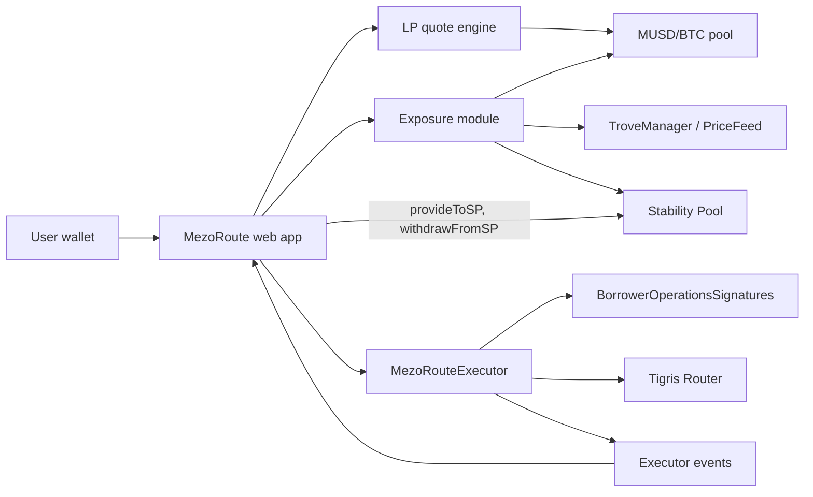

# MezoRoute

**Where should your MUSD go, and what does it do to your BTC risk?**

MezoRoute shows Mezo borrowers where to put their MUSD (the MUSD/BTC liquidity pool or the MUSD Stability Pool) by what each choice does to their BTC exposure, then executes the choice safely. Borrow → swap → add liquidity happens in **one transaction and two off-chain signatures**, and every number on a receipt comes from on-chain events, not wallet balance changes.

- **Live app:** https://mezoroute.vercel.app (testnet by default; switch to mainnet in the header)
- **Mainnet executor:** [`0x046449b1229C863e278f369869BA10e12bd80d9E`](https://explorer.mezo.org/address/0x046449b1229C863e278f369869BA10e12bd80d9E) (verified, capped at 1,000 MUSD per entry)
- **Hackathon:** Build with MUSD and MEZO, AKINDO WaveHack, Wave 1. Track 2 (Access and Distribution) and Track 1 (DeFi)
- **Demo video:** https://www.youtube.com/watch?v=wDJtaaEwrnk
- **Deck:** [docs/submission/mezoroute-wave1-deck.pdf](docs/submission/mezoroute-wave1-deck.pdf)

## Try it in five minutes (testnet)

The app opens on Mezo testnet. Everything except Borrow & Deploy works with a few test MUSD in your wallet.

1. **Look around without funds.** The landing page's simulator runs on live mainnet data, no wallet needed. Connect a wallet to see the dashboard: your Trove, your BTC exposure, and Compare routes, which starts filled with an example amount.
2. **Get test BTC.** Request BTC from the [Mezo faucet](https://faucet.test.mezo.org) for the address in MezoRoute's account menu. BTC pays for gas on Mezo. With a Bitcoin wallet, that address is your Mezo smart account, not your Bitcoin address, and it needs BTC before its first transaction.
3. **Get MUSD.** In the [Mezo testnet app](https://testnet.mezo.org), swap some test BTC for MUSD. 20 MUSD is plenty.
4. **LP route.** In Compare routes, choose Deposit to LP. An EVM wallet signs one permit and sends one transaction; a Bitcoin wallet sends an approval and the deposit. The receipt is decoded from the executor's `Entered` event.
5. **Positions.** See the LP value, claimable trading fees, and cost basis. Claim the fees, then exit to MUSD at 25/50/75% or Max.
6. **Stability Pool.** Choose Deposit to Stability Pool, then withdraw or claim BTC gains from Positions.

**Borrow & Deploy** needs an EVM wallet and an open Trove. Opening one in the Mezo testnet app takes at least 1,800 MUSD of debt, so it needs more test BTC than the steps above; the [demo video](https://www.youtube.com/watch?v=wDJtaaEwrnk) shows the whole flow.

## The problem

A Mezo user who wants to put MUSD to work runs into four problems:

1. **No side-by-side comparison.** The MUSD/BTC pool and the Stability Pool earn from different sources and carry different risks. Nothing compares them.
2. **Fragmented execution.** Borrowing, swapping, and adding liquidity are separate actions, approvals, and transactions.
3. **Hidden compounding of BTC risk.** Borrowing MUSD against BTC and depositing it into a MUSD/BTC pool *increases* BTC exposure: a BTC drop lowers the Trove's collateral ratio and the LP value at the same time. No interface shows the Trove and the positions together.
4. **Misleading accounting.** Velodrome-style routers (including Mezo's Tigris Router) hand any balance already sitting in the router to the current caller. On testnet we saw a zap return 10.47 MUSD that was not the user's, which a balance-diff dashboard would show as profit.

## What MezoRoute does

| | |
|---|---|
| **Dashboard** | Trove, collateral ratio, balances, and readiness in one view, read from a single multicall so every figure comes from the same block. |
| **Compare routes** | LP vs Stability Pool for the amount you type: return source, risks, fee, BTC exposure after, and 30-day on-chain results (LP fee growth and a Stability Pool backtest using Liquity's own maths). |
| **"If BTC moves" chart** | What a −30% … +30% BTC move does to your Trove ratio and position values, including where the Trove would cross the minimum collateral ratio. |
| **LP route** | Deposit wallet MUSD into the MUSD/BTC pool through the executor. The app computes the optimal swap to the wei (it mirrors the pool's rounding; replays of every live entry match exactly), sets on-chain minimums, and uses an EIP-2612 permit instead of an approval transaction. |
| **Borrow & Deploy** | For an existing Trove: sign a borrow authorisation and a permit, send one transaction. The executor borrows through Mezo's `BorrowerOperationsSignatures` and deposits into the pool. The borrowed MUSD always goes to the borrower. |
| **Stability Pool** | Deposit, withdraw, and claim BTC gains with direct calls to Mezo's Stability Pool (no executor, no fee). |
| **Positions** | LP value, claimable trading fees (with a Claim button), Stability Pool deposit and BTC gain, and cost basis rebuilt from executor events. Exit LP to MUSD at 25/50/75% or Max. |
| **Receipts** | Every result is decoded from executor or Stability Pool events, with an explorer link. Reloading the receipt page keeps tracking the transaction. |
| **Both wallet types** | EVM wallets (MetaMask, WalletConnect) and Bitcoin wallets (Unisat and others) through [Mezo Passport](https://www.npmjs.com/package/@mezo-org/passport). Bitcoin wallets act through an OrangeKit smart account, so they use approvals instead of permits and cannot use Borrow & Deploy. |
| **Mezo terms explained** | Trove, MCR, Stability Pool and other Mezo-specific terms show a one-sentence definition on hover or tap. |

What it deliberately does not do: no unverified APY, no simulated yield, no arbitrary routing, no automated rebalancing, and user funds never rest in MezoRoute contracts between transactions.

## How it works



- **No backend.** The app is a static Next.js export hosted on Vercel. It reads Mezo through the RPC and builds history from contract events (and the explorer's Blockscout API for Stability Pool history).
- **`MezoRouteExecutor`** ([`contracts/src/MezoRouteExecutor.sol`](contracts/src/MezoRouteExecutor.sol)) is a fixed-route, non-custodial executor for the MUSD/BTC volatile pool with three entry points:
  - `enter(params, musdPermit)`: MUSD → optimal swap to BTC → add liquidity → LP to the recipient, refunding leftovers.
  - `borrowAndEnter(borrow, musdPermit, params)`: borrows MUSD to the caller with their EIP-712 authorisation, then the same entry.
  - `exit(params, lpPermit)`: LP → remove liquidity → swap BTC back → MUSD to the recipient.

### Safety properties

The executor is small (about 260 lines of logic) and built so that a bug cannot reach more than one transaction's funds:

- Calls only the fixed MUSD, BTC, Router, pool, and `BorrowerOperationsSignatures`; it accepts no user-supplied target, token, or route.
- Every payout is a balance delta measured inside the call, so balances already held by the executor can never be paid out.
- Allowances are exact and reset to zero before the call returns; every entry point is `nonReentrant`.
- Minimums and deadlines are enforced on-chain at every step.
- Borrowed MUSD only ever goes to the borrower, and only the borrower can call `borrowAndEnter`.
- No owner, admin, pause, proxy, or withdrawal path. Fee, fee recipient, and cap are immutable.
- Immutable per-transaction entry cap: 1,000 MUSD on mainnet. Exits are never capped.

Each invariant is mapped to its tests in [`contracts/SELF_AUDIT.md`](contracts/SELF_AUDIT.md).

## Deployments

| Contract | Mezo mainnet (31612) | Mezo testnet (31611) |
|---|---|---|
| **MezoRouteExecutor** | [`0x046449b1229C863e278f369869BA10e12bd80d9E`](https://explorer.mezo.org/address/0x046449b1229C863e278f369869BA10e12bd80d9E) (cap 1,000 MUSD, fee 10 bps) | [`0xB36B2E012003840951CFf00fA6b1E3237A110920`](https://explorer.test.mezo.org/address/0xB36B2E012003840951CFf00fA6b1E3237A110920) (cap 1,000,000 MUSD, fee 10 bps) |
| MUSD | `0xdD468A1DDc392dcdbEf6db6e34E89AA338F9F186` | `0x118917a40FAF1CD7a13dB0Ef56C86De7973Ac503` |
| BTC (ERC-20 interface) | `0x7b7C000000000000000000000000000000000000` | `0x7b7C000000000000000000000000000000000000` |
| MUSD/BTC pool (volatile) | `0x52e604c44417233b6CcEDDDc0d640A405Caacefb` | `0xd16A5Df82120ED8D626a1a15232bFcE2366d6AA9` |
| Tigris Router | `0x16A76d3cd3C1e3CE843C6680d6B37E9116b5C706` | `0x9a1ff7FE3a0F69959A3fBa1F1e5ee18e1A9CD7E9` |
| BorrowerOperationsSignatures | `0xB57ab578BF20b3e318f3EFAA587C51DBccE5df7a` | `0xD757e3646AF370b15f32EB557F0F8380Df7D639e` |
| StabilityPool | `0x73245Eff485aB3AAc1158B3c4d8f4b23797B0e32` | `0x1CCA7E410eE41739792eA0A24e00349Dd247680e` |

Both executors are verified on the Mezo explorer. Every address the app uses lives in [`frontend/src/lib/config/networks.ts`](frontend/src/lib/config/networks.ts).

### Mainnet round trip through the UI (15 Oct 2026)

| Step | Transaction |
|---|---|
| Executor deployment | [`0x8aa5…b71d`](https://explorer.mezo.org/tx/0x8aa55418f1da98ea1700c9e950f01d8cadf94fc34633650f5e60f9e68aafb71d) |
| Stability Pool deposit, 10 MUSD | [`0x060d…b7fe`](https://explorer.mezo.org/tx/0x060d441ea7f4fd7b1162219c021c7fa14d1851ea58e9e0da3219b6ce2eb0b7fe) |
| Stability Pool withdrawal, 10 MUSD | [`0xaf96…2bb6`](https://explorer.mezo.org/tx/0xaf96787a5a56aa9843885c5fdcafd27ae50e07832206de8aca7a592387df2bb6) |
| LP entry with permit, 10 MUSD → 0.017446 LP | [`0xb401…60fb`](https://explorer.mezo.org/tx/0xb401267a1a3789c8e5b7d3ba3ace8c307d29adabccd08d665a1bd7c1497860fb) |
| Claim LP trading fees | [`0xde86…3521`](https://explorer.mezo.org/tx/0xde86d4c16f4a72f023f3ec25c81523e7fe6ed6255e55686e5f66793103623521) |
| LP exit (Max) with permit → 9.9636 MUSD | [`0x48c1…7147`](https://explorer.mezo.org/tx/0x48c1cb0d720b319d8e82055e0d02a0425b24182308bd22123e248c5c6ef97147) |

The LP round trip cost 0.0264 MUSD on 10 MUSD, pool swap fees and price impact included. Replaying the entry through the app's quote engine matches it to the wei, and the executor held no MUSD, BTC, or LP afterwards. Testnet smoke runs (enter, exit, `borrowAndEnter`) are listed in [`contracts/README.md`](contracts/README.md).

## Business model

A disclosed execution fee of **10 bps** on MUSD entering the LP route through the executor (`enter` and `borrowAndEnter`), hard-capped at 50 bps in the contract and fixed at deployment. The fee is shown in bps and MUSD before signing and emitted in the `Entered` event. Exits and Stability Pool actions are free. The mainnet executor charges it on real deposits today.

For Mezo, Borrow & Deploy mints new MUSD and deepens the MUSD/BTC pool, and the route comparison points idle MUSD at Mezo's own destinations.

## MUSD, not MEZO

MezoRoute integrates MUSD across three protocol surfaces: borrowing through `BorrowerOperationsSignatures`, the MUSD/BTC pool, and the Stability Pool. It does **not** integrate MEZO. Our on-chain research (30 Sep 2026) found that Mezo's gauges pay BTC rather than MEZO, veMEZO is not deployed, and the mainnet MUSD/BTC pools have no gauge. With no MEZO-paying surface for this use case, we chose a deep MUSD integration over a superficial MEZO one.

## Limitations

- **Unaudited.** The executor has a self-audit ([`contracts/SELF_AUDIT.md`](contracts/SELF_AUDIT.md)), unit, fuzz, and invariant tests, but no external audit. That is why mainnet entries are capped at 1,000 MUSD per transaction and the app shows an "Unaudited" banner on mainnet.
- **Bitcoin wallets are tested on testnet only.** On testnet a real Unisat wallet deployed its smart account, approved MUSD, and entered the LP route through Mezo's relayer ([spike S1](docs/spikes/s1-passport-static-export.md)). The mainnet relayer answers the same way, but no real Bitcoin-wallet transaction has gone through it yet. A new smart account on mainnet also needs BTC first, which now arrives only as tBTC from Ethereum (see Mainnet funding below).
- **Borrow & Deploy needs an EVM wallet and an existing Trove.** The borrow authorisation is verified with `ecrecover`, which smart accounts (Bitcoin wallets via Passport) cannot produce. The app does not open Troves; Mezo's minimum debt is 1,800 MUSD.
- **Thin mainnet pool.** The mainnet MUSD/BTC basic pool is small, so the app blocks any entry whose swap would move the price by more than 5%.
- **Stability Pool withdrawals pause** while any Trove is below the minimum collateral ratio (a Mezo rule). The app shows that state and still offers claiming BTC gains.
- **Mainnet funding.** Mezo's native BTC bridge-in closed on 13 Oct 2026; BTC now arrives as tBTC from Ethereum through the Mezo app.
- **No gauge staking or MEZO rewards** (see above).

## Run it locally

Requirements: Node.js 18.17+ (developed on Node 24), npm, and [Foundry](https://book.getfoundry.sh/).

### Contracts

```bash
cd contracts
forge build
forge test        # 75 tests: unit, fuzz, invariant
```

Tests deploy the real Tigris Pool, PoolFactory, and Router (commit `0a3b5e8`) locally with mock MUSD and BTC. Fork tests are not possible because Mezo's BTC token is a chain precompile; [`contracts/script/smoke-testnet.sh`](contracts/script/smoke-testnet.sh) exercises a deployed executor on Mezo testnet instead. Deployment steps are in [`contracts/README.md`](contracts/README.md).

### Frontend

```bash
cd frontend
npm install
cp .env.example .env.local   # set NEXT_PUBLIC_WALLETCONNECT_PROJECT_ID (free at cloud.reown.com)
npm run dev                  # http://localhost:3000
npm test                     # 962 Vitest tests
npm run build                # static export to out/, with lint and type check
```

`npm run quote-accuracy` replays every executor entry on testnet against the quote engine (`QUOTE_NETWORK=mainnet` for mainnet). To get test funds, see [Try it in five minutes](#try-it-in-five-minutes-testnet).

Stack: Solidity 0.8.24 (London EVM), Foundry, OpenZeppelin 4.9.0; Next.js 14 (static export), React 18, Mezo Passport 0.17.2, RainbowKit 2, wagmi 2, viem 2, Tailwind CSS, Vitest.

## Repository

```
contracts/          MezoRouteExecutor, tests, deploy and smoke scripts, self-audit
frontend/           Next.js app (src/lib holds the pure maths: quotes, exposure, Trove, history)
PRODUCT_SPEC.md     product and technical specification: scope, research, invariants
docs/               build status, feature designs, and the Passport spike
```

## Roadmap

1. **Wave 2 (by 15 Nov 2026):** one-transaction BTC leverage and unwind on MUSD Troves using Tigris flash swaps, on testnet and capped mainnet.
2. **After the hackathon:** more routes as separate executors, and opening a Trove in the same flow.
3. **After the hackathon:** smart-account support for Borrow & Deploy, and an external audit before raising the cap.

## License

MIT (see the SPDX header in [`contracts/src/MezoRouteExecutor.sol`](contracts/src/MezoRouteExecutor.sol)).
